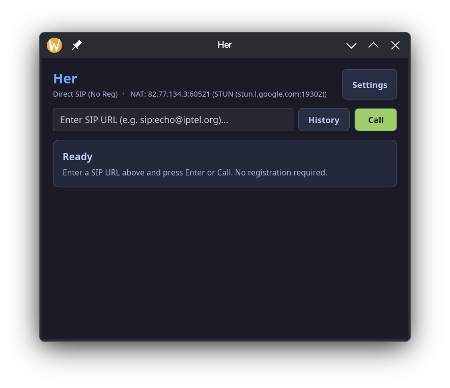

# Her

A lightweight, pure-Rust SIP phone with a **Tokyo Night** [Slint](https://slint.dev/) UI, built-in NAT traversal, optional SIP registration, pure-Rust audio codecs, and keyboard-to-DTMF.



## Features

- **Minimal Interface (No Keypad)**: Single SIP URL input box with persisted call history dropdown (`History`) and `Call` / `Hangup`, `Mute`, `Hold`, `Answer` / `Decline`.
- **Keyboard-to-DTMF**: During an active call, physical keyboard keys `0–9`, `*`, `#`, `A–D` are translated directly to DTMF (`RFC 4733` RTP `telephone-event` and/or `SIP INFO`) with local dual-tone sidetone feedback.
- **SIP URL Dialing & Optional Registration**:
  - Works out of the box with zero configuration for direct SIP URL dialing (e.g., `sip:echo@iptel.org`).
  - Optional SIP registration with Digest Authentication (`MD5` / `SHA-256`), outbound proxy, and automatic re-registration.
- **NAT Traversal**:
  - **STUN (RFC 5389)** enabled by default using `stun.l.google.com:19302` (with `stun1.l.google.com:19302` fallback) — no initial setup required.
  - **SIP `rport` (RFC 3581)** & `received=` external address learning.
  - **Symmetric RTP** latching for media behind NAT.
  - Configurable periodic **CRLF NAT keepalives**.
- **Pure-Rust Codecs**:
  - **G.722** (16 kHz wideband)
  - **PCMU** (G.711 µ-law, 8 kHz)
  - **PCMA** (G.711 A-law, 8 kHz)
  - **G.729** (8 kbit/s CS-ACELP, pure Rust via `oxideav-g729`)
- **Cross-Platform**: Prebuilt releases for Linux (`amd64` / `arm64`, `.AppImage` & `.tar.gz`), macOS (`arm64`), and Windows (`amd64`).

## Downloads

Prebuilt binaries and Linux `.AppImage` packages are available on the [Releases](https://github.com/sigxcpu76/her/releases) page.

## Building from Source

### Linux System Dependencies
```bash
# Debian / Ubuntu
sudo apt-get install pkg-config libasound2-dev libfontconfig1-dev libfreetype-dev \
  libdbus-1-dev libgl-dev libegl-dev libxkbcommon-dev libxkbcommon-x11-dev \
  libwayland-dev libx11-dev libxcursor-dev libxi-dev libxrandr-dev
```

### Build & Run
```bash
cargo run --release
```

### Run Tests
```bash
cargo test
```
